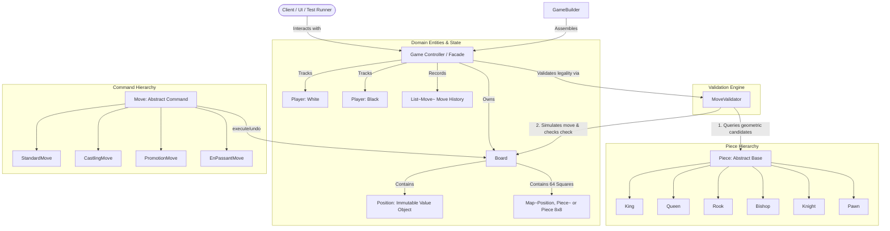

# Chess Game — Architectural Blueprint & System Requirements

A production-grade, object-oriented Low-Level Design (LLD) specification for a two-player, turn-based Chess Game in Java 21 adhering to SOLID principles and GoF Design Patterns.

---

## 1. System Requirements Matrix

| # | Requirement | Description | Architectural Pattern / Mechanism |
| :---: | :--- | :--- | :--- |
| **1** | **8x8 Chessboard** | 64 squares with algebraic coordinates (A1–H8) and rank/file mapping. | `Board`, `Position` (Immutable Value Object / Flyweight) |
| **2** | **Standard Pieces** | King, Queen, Rook, Bishop, Knight, Pawn with color differentiation (White & Black). | `Piece` hierarchy, `PieceColor` enum |
| **3** | **Movement Validation** | Separation of geometric path traversal from King-safety / pin validation. | Two-phase validation: `getPseudoLegalMoves()` + `isKingInCheck()` check |
| **4** | **Move Execution & Undo** | Encapsulated move commands supporting do/undo for simulation, history, and rollback. | `Move` hierarchy (Command Pattern) |
| **5** | **Castling** | Both Kingside (O-O) and Queenside (O-O-O) with strict safety interlocks. | `CastlingMove` (Command Pattern subclass) |
| **6** | **Pawn Promotion** | Automatic or chosen promotion to Queen, Rook, Bishop, or Knight upon reaching the 8th rank. | `PromotionMove`, `PieceFactory` |
| **7** | **En Passant** | Special pawn capture permitted only on the immediate subsequent turn following a 2-square advance. | `EnPassantMove`, `Board.lastMove` state |
| **8** | **Check, Checkmate & Stalemate** | Real-time game state tracking: active check, checkmate, stalemate, and 50-move / insufficient material draws. | `GameStatus`, `GameStateEvaluator` |
| **9** | **Turn-Based Gameplay** | Two-player alternation enforcing valid turn order, timing, and captured piece logging. | `Game`, `Player`, `TurnManager` |
| **10**| **Flexible Assembly** | Fluent setup for standard starting boards, custom end-game test layouts, and time controls. | `GameBuilder` (Builder Pattern) |

---

## 2. Domain Decomposition & Component Boundaries

---

## 3. Core Architectural Decisions

### Decision 1: Immutable `Position` vs. Mutable `Cell`
* **Decision**: Represent board coordinates using an immutable `Position` (Value Object / Flyweight) instead of a stateful `Cell`.
* **Rationale**:
  - `Cell` combines spatial coordinates (`x, y`) with mutable piece state (`setPiece()`), violating the **Single Responsibility Principle**.
  - A mutable `Cell` passed across methods can be manipulated outside the `Board` aggregate root, risking state desynchronization.
  - `Position` is completely immutable, thread-safe, and supports algebraic notation (e.g. `Position.of("e4")`), making unit tests readable and bug-free.

### Decision 2: Two-Phase Move Validation (Pseudo-Legal vs. Legal)
* **Decision**: `Piece` calculates pure geometric/pseudo-legal moves; `MoveValidator` ensures King safety.
* **Rationale**:
  - A piece cannot know if a move is legal without checking if its King is in check.
  - If `Piece` tries to check for check, it creates a circular dependency: `Piece -> Board -> Game -> Piece`.
  - **Phase 1 (Geometric / Pseudo-Legal)**: Piece evaluates movement vectors, collision with friendly pieces, and board boundaries.
  - **Phase 2 (King Safety / True Legal)**: The engine executes the candidate move, verifies that `isKingUnderAttack()` is false, and rolls the move back via `undo()`.

### Decision 3: The Command Pattern for Moves
* **Decision**: Model all moves as concrete command objects implementing `execute(Board)` and `undo(Board)`.
* **Rationale**:
  - Enables effortless move history, replayability, and PGN (Portable Game Notation) export.
  - Cleanly handles complex special-case side effects (e.g., castling moves both King and Rook; en passant removes a pawn on a different square than the target destination; promotion transforms a pawn into another piece) without branching `if/else` ladders inside `Board`.

### Decision 4: Single Source of Truth for Pieces
* **Decision**: The `Board` is the single authority for piece locations.
* **Rationale**:
  - Storing pieces inside both `Player.pieces` and `Board.cells` inevitably leads to synchronization drift when pieces are captured or promoted.
  - `Player` records only their identity, color, and `capturedPieces` list.

---

## 4. Class Responsibilities & Contracts

### 1. Primitives & Value Objects
* **`PieceColor`** (`enum`): `WHITE`, `BLACK`.
* **`GameStatus`** (`enum`): `NOT_STARTED`, `IN_PROGRESS`, `CHECK`, `CHECKMATE`, `STALEMATE`, `DRAW`.
* **`Position`** (`record` / `class`): 
  - `int row` (0–7), `int col` (0–7).
  - Factory: `Position.of(int row, int col)`, `Position.of(String algebraic)` (e.g., `"e4"`).
  - Relative helpers: `position.offset(int rowDelta, int colDelta)`.

### 2. Piece Hierarchy (`com.chess.piece`)
* **`Piece`** (`abstract class`):
  - Attributes: `PieceColor color`, `boolean hasMoved`.
  - Methods: `abstract List<Position> getPseudoLegalMoves(Board board, Position currentPos)`.
* **Subclasses**: `King`, `Queen`, `Rook`, `Bishop`, `Knight`, `Pawn`.

### 3. Move Hierarchy (`com.chess.command`)
* **`Move`** (`abstract class`):
  - Attributes: `Position start`, `Position end`, `Piece movedPiece`, `Piece capturedPiece`.
  - Contract: `void execute(Board board)`, `void undo(Board board)`.
* **`StandardMove`**: Standard movement and captures.
* **`CastlingMove`**: Moves King 2 squares and relocates corresponding Rook.
* **`PromotionMove`**: Replaces Pawn at 8th rank with chosen promoted piece.
* **`EnPassantMove`**: Captures enemy pawn on adjacent file behind target square.

### 4. Board & Game Controller (`com.chess.model`)
* **`Board`**:
  - Holds 8x8 piece grid / coordinate map.
  - Tracks `lastMove` for En Passant qualification.
  - Methods: `getPiece(Position)`, `setPiece(Position, Piece)`, `isKingInCheck(PieceColor)`, `findKing(PieceColor)`.
* **`Game`**:
  - Orchestrates players, turns (`currentTurn`), clock, and game status.
  - Methods: `makeMove(Position start, Position end)`, `isCheckmate()`, `isStalemate()`.

