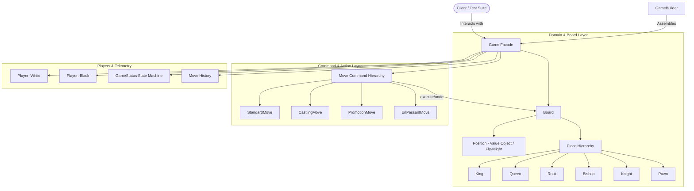

# Chess Game — Low-Level Design (LLD)

A production-grade, object-oriented Low-Level Design for a standard two-player Chess Game implemented in Java 21 adhering to clean architecture, SOLID principles, and GoF design patterns.

---

## 1. System Requirements & Feature Matrix

| # | Requirement | Implementation Details | Design Pattern / Architecture |
| :---: | :--- | :--- | :--- |
| **1** | **8x8 Chessboard Representation** | Canonical 64 squares with algebraic notation (`A1` to `H8`) and bounds safety. | `Board`, `Position` (Immutable Value Object / Flyweight) |
| **2** | **Full Piece Roster** | King, Queen, Rook, Bishop, Knight, and Pawn with color differentiation. | `Piece` hierarchy, `PieceColor` enum |
| **3** | **Special Chess Rules** | En Passant, Castling (Kingside & Queenside), and Pawn Promotion to Queen/Rook/Bishop/Knight. | `CastlingMove`, `PromotionMove`, `EnPassantMove` |
| **4** | **Two-Phase Move Validation** | Geometric trajectory evaluation cleanly separated from King-safety / pin checks. | `Piece.getPseudoLegalMoves()` + `MoveValidator` |
| **5** | **Move Execution & Rollback** | Encapsulated move commands with `execute()` and `undo()` for simulation & check validation. | `Move` hierarchy (Command Pattern) |
| **6** | **Game State Tracking** | Active state machine tracking `IN_PROGRESS`, `CHECK`, `CHECKMATE`, `STALEMATE`, and `DRAW`. | `GameStatus`, `GameStateEvaluator` |
| **7** | **Turn Management** | Two-player alternation enforcing valid turn order and capture history. | `Game`, `Player`, `TurnManager` |
| **8** | **Flexible Assembly** | Fluent setup for standard starting boards or custom endgame testing positions. | `GameBuilder` (Builder Pattern) |

---

## 2. High-Level Architecture

---

## 3. Detailed Specifications

For in-depth architectural rationale, SOLID breakdowns, and design pattern justifications, see [ChessDesign.md](ChessDesign.md).
